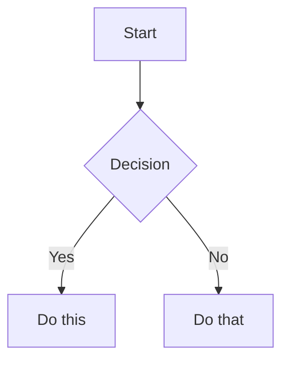

# Obsidian Flavored Markdown Skill

Crea y edita Obsidian Flavored Markdown válido. Obsidian extiende CommonMark y GFM con wikilinks, embeds, callouts, properties, comentarios y otras sintaxis. Esta skill cubre solo las extensiones específicas de Obsidian; se asume que conoces el Markdown estándar (encabezados, negrita, cursiva, listas, citas, bloques de código, tablas).

## Flujo de trabajo: crear una nota de Obsidian

1. **Agrega frontmatter** con properties (title, tags, aliases) al inicio del archivo. Consulta [PROPERTIES.md](references/PROPERTIES.md) para todos los tipos de property.
2. **Escribe el contenido** usando Markdown estándar para la estructura, más la sintaxis específica de Obsidian de abajo.
3. **Enlaza notas relacionadas** usando wikilinks (`[[Note]]`) para conexiones internas del vault, o enlaces Markdown estándar para URLs externas.
4. **Inserta contenido** de otras notas, imágenes o PDFs usando la sintaxis `![[embed]]`. Consulta [EMBEDS.md](references/EMBEDS.md) para todos los tipos de embed.
5. **Agrega callouts** para información destacada usando la sintaxis `> [!type]`. Consulta [CALLOUTS.md](references/CALLOUTS.md) para todos los tipos de callout.
6. **Verifica** que la nota se renderice correctamente en la vista de lectura de Obsidian.

> Al elegir entre wikilinks y enlaces Markdown: usa `[[wikilinks]]` para notas dentro del vault (Obsidian actualiza los renombres automáticamente) y `[text](url)` solo para URLs externas.

## Enlaces internos (wikilinks)

```markdown
[[Note Name]]                          Link to note
[[Note Name|Display Text]]             Custom display text
[[Note Name#Heading]]                  Link to heading
[[Note Name#^block-id]]                Link to block
[[#Heading in same note]]              Same-note heading link
```
Dentro de tablas Markdown, escapa los pipes de alias de wikilink como `[[Note\|Alias]]` para que el separador de alias no se interprete como delimitador de celda de tabla. Cuando una tabla sigue a un párrafo, deja una línea en blanco encima, o se renderizará como texto plano.

Los enlaces se resuelven por nombre de archivo, no por la property `aliases`. Un `[[Alias]]` solo queda sin resolver; escribe `[[Note|Alias]]` para mostrar un alias.

Define un block ID agregando `^block-id` al final de cualquier párrafo:

```markdown
This paragraph can be linked to. ^my-block-id
```

Para listas y citas, coloca el block ID en una línea separada después del bloque:

```markdown
> A quote block

^quote-id
```

## Embeds

Antepone `!` a cualquier wikilink para insertar su contenido en línea:

```markdown
![[Note Name]]                         Embed full note
![[Note Name#Heading]]                 Embed section
![[image.png]]                         Embed image
![[image.png|300]]                     Embed image with width
![[document.pdf#page=3]]               Embed PDF page
```

Consulta [EMBEDS.md](references/EMBEDS.md) para embeds de audio, video, búsquedas e imágenes externas.

## Callouts

```markdown
> [!note]
> Basic callout.

> [!warning] Custom Title
> Callout with a custom title.

> [!faq]- Collapsed by default
> Foldable callout (- collapsed, + expanded).
```

Tipos comunes: `note`, `tip`, `warning`, `info`, `example`, `quote`, `bug`, `danger`, `success`, `failure`, `question`, `abstract`, `todo`.

Consulta [CALLOUTS.md](references/CALLOUTS.md) para la lista completa con alias, anidamiento y callouts personalizados con CSS.

## Properties (frontmatter)

```yaml
---
title: My Note
date: 2024-01-15
tags:
  - project
  - active
aliases:
  - Alternative Name
cssclasses:
  - custom-class
---
```

Properties por defecto: `tags` (etiquetas buscables), `aliases` (nombres alternativos que se ofrecen en las sugerencias de enlaces; los enlaces siguen usando el nombre del archivo), `cssclasses` (clases CSS para estilos).

Consulta [PROPERTIES.md](references/PROPERTIES.md) para todos los tipos de property, las reglas de sintaxis de tags y uso avanzado.

## Tags

```markdown
#tag                    Inline tag
#nested/tag             Nested tag with hierarchy
```

Los tags pueden contener letras, números, guiones bajos, guiones y barras diagonales, pero deben incluir al menos un carácter no numérico (`#1984` no es válido, `#1984book` sí lo es). Un espacio termina un tag, así que `#my tag` es el tag `#my`. Los tags también pueden definirse en el frontmatter bajo la property `tags`.

## Comentarios

```markdown
This is visible %%but this is hidden%% text.

%%
This entire block is hidden in reading view.
%%
```

## Formato específico de Obsidian

```markdown
==Highlighted text==                   Highlight syntax
==🔴Highlighted text==                 Colored highlight (Obsidian 1.14.1 and later)
```

Un highlight de color comienza con 🔴, 🟠, 🟡, 🟢, 🔵 o 🟣 (o el cuadrado correspondiente) inmediatamente después de `==`. Otros emojis permanecen como texto.

## Matemáticas (LaTeX)

```markdown
Inline: $e^{i\pi} + 1 = 0$

Block:
$$
\frac{a}{b} = c
$$
```

## Diagramas (Mermaid)

````markdown

````

Para enlazar nodos Mermaid a notas de Obsidian, agrega `class NodeName internal-link;`.

## Notas al pie

```markdown
Text with a footnote[^1].

[^1]: Footnote content.

Inline footnote.^[This is inline.]
```

## Ejemplo completo

````markdown
---
title: Project Alpha
date: 2024-01-15
tags:
  - project
  - active
status: in-progress
---

# Project Alpha

This project aims to [[improve workflow]] using modern techniques.

> [!important] Key Deadline
> The first milestone is due on ==January 30th==.

## Tasks

- [x] Initial planning
- [ ] Development phase
  - [ ] Backend implementation
  - [ ] Frontend design

## Notes

The algorithm uses $O(n \log n)$ sorting. See [[Algorithm Notes#Sorting]] for details.

![[Architecture Diagram.png|600]]

Reviewed in [[Meeting Notes 2024-01-10#Decisions]].
````

## Referencias

- [Obsidian Flavored Markdown](https://help.obsidian.md/obsidian-flavored-markdown)
- [Internal links](https://help.obsidian.md/links)
- [Embed files](https://help.obsidian.md/embeds)
- [Callouts](https://help.obsidian.md/callouts)
- [Properties](https://help.obsidian.md/properties)
