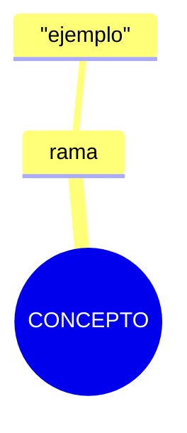

# Cómo Sebastian trabaja cada tipo de documento en su vault

Guía imperativa para escribir en el vault de Sebastian (`P:\.obsidian`, Git Bash: `/p/.obsidian`) tal como él lo hace. Aplica a **toda nota del vault EXCEPTO `sebastian/definitions/`** (ese glosario tiene su propio esquema atomic con frontmatter estricto: si una nota pertenece ahí, copia el frontmatter de una nota reciente de esa carpeta — no inventes campos ni apliques esta skill).

El vault es la capa de **conocimiento curado**. Los repos de código viven en `P:\.workspace` (no los toques con esta skill).

## 0. Mapa de enrutado: ¿dónde va cada cosa?

| Contenido nuevo | Ruta destino |
|---|---|
| Servicio/concepto de un proveedor cloud | `sebastian/cloud-computing/<vendor>/<categoría>/<slug>.md` |
| Hub de un proveedor cloud | `sebastian/cloud-computing/<vendor>/<vendor>.md` (ya existen: amazon-web-service, microsoft, alphabet, oracle, alibaba…) |
| Herramienta de desarrollo | `sebastian/entwicklerin/<herramienta>/<herramienta>.md` |
| Agente/modelo de IA | `sebastian/künstliche-intelligenz/agents/<agente>.md` |
| Concepto de programación/lenguaje | `sebastian/programmiersprachen/<slug>.md` (leafs prefijados: `programmiersprachen-*`, `package-manager-*`) |
| Digest de comandos CLI / operación de una herramienta | `sebastian/assets/documents/process/process-<herramienta>.md` |
| Laboratorio cloud hands-on | `sebastian/assets/laboratorium/<aws\|az\|gcp\|mpp>-<slug>/` (carpeta propia) |
| Capturas/screenshots de un lab | `sebastian/assets/multimedia/` (pool global, embed por nombre desnudo) |
| Tareas de un área | `sebastian/kanban/kanban-<área>.md` (el de ecommerce vive en `unternehmer/kanban/`) |
| Apuntes de colegio (3º ESO) | `sebastian/sebastian/סַיִף/` |
| Dossier de entrevista / carrera | sección nueva dentro de `sebastian/sebastian/יַזָם.md` |
| Nota retirada | renombrar con prefijo `trash-` y enlazarla desde `sebastian/sebastian/אַשְׁפָּה/` |
| Negocio (ERP, ecommerce, subvenciones) | `unternehmer/<área>/` |
| Estudio bíblico | `sebastian/sebastian/יהוה/` |

Si el área no existe, crea la carpeta + su **hub** (§2) antes que el leaf. Nunca crees carpetas con nombres en hebreo nuevos sin que Sebastian lo pida.

## 1. Capa de idiomas (regla inquebrantable)

- **Carpetas:** mantener el idioma ya establecido de la rama (taxonomía en alemán: `entwicklerin`, `systemtechnik`…). Las excepciones existentes NO se "corrigen": `architecture-logicielle` está en francés, `programmiersprachen/lenguajes/` en español.
- **Contenido de notas:** 100% español con tecnicismos en inglés sin traducir (VPC, IAM, RAG). Sebastian aplica des-branding deliberado cuando el contexto es conceptual: "Simple Storage Service" en vez de "S3".
- **Filenames y slugs/ids:** inglés kebab-case; puede divergir del término español y es normal (`spear-phishing-ejecutivo.md` ↔ alias "whaling").
- **Fechas frontmatter:** ISO `YYYY-MM-DD`. Zona horaria de referencia: Europe/Madrid.

## 2. Firma de estilo universal (aplica a TODA nota)

1. **Sin título H1.** La nota abre directamente con contenido o con el bloque de enlaces.
2. **Bullet firma:** `-  **Etiqueta**` (guion + **DOS** espacios + negrita), explicación en la línea siguiente indentada con **tab**. El outline de bullets ES el sistema de jerarquía; encabezados reales solo en documentos largos (`###`/`####`, nunca `#`/`##`).
3. **Resaltado de comandos/valores:** `**``comando``**` (negrita conteniendo doble backtick). En notas de `cloud-computing` NO uses fenced code blocks: el código se indenta con tabs dentro de la lista. Fences con lenguaje sí están permitidos en `entwicklerin`/`künstliche-intelligenz` cuando hay scripts reales.
4. **Separador visual:** `![[barra.gif]]` — siempre en minúsculas exactas. Cierra el bloque de enlaces y separa secciones mayores.
5. **Enlaces externos:** `-  **[Texto ](https://…)**` — negrita, y **espacio final dentro del corchete** (es su firma, respétala).
6. **Extranjerismos en cursiva:** `_zero day_`, `_benchmark_`.
7. **Tono didáctico de digest:** Q&A retórico (`**¿Qué significa?:**`, `¿Por qué…?`), analogías ("DataSync = El Camión de Mudanza"). Prosa en segunda persona solo en transcripciones de chat (§7).
8. **Imágenes:** guardar en `sebastian/assets/multimedia/` con nombre descriptivo kebab-case español (`jerarquia-organizacional.png`) y embederlas por nombre desnudo `![[nombre.webp]]`. Modificadores permitidos: `#invert`, `#blend`.
9. **No "limpies" blank lines heredadas** ni reformatees bullets existentes si solo vas a añadir contenido: el vault conserva colas de líneas vacías y mezclas `-  `/`- ` como cicatrices de paste — son parte del terreno.
10. **Sin tags/frontmatter genéricos** salvo en los tipos que sí los llevan (§5–§8). No añadas tags "por higiene".

## 3. Árbol de decisión: ¿qué tipo de documento creo?

```
¿El contenido son TAREAS pendientes de un área?             → Kanban (§5)
¿Es un laboratorio cloud hands-on con consola/IaC?          → Lab (§6)
¿Es una transcripción o digest de una conversación con IA?  → Captura IA (§7)
¿Son apuntes de clase (3º ESO)?                             → Colegio (§8)
¿Es preparación de entrevista/carrera?                      → Sección en יַזָם.md (§9)
¿Es un tema nuevo de un área existente, aún sin estudiar?   → Stub (§4)
¿Es un tema nuevo ya estudiado/asimilado?                   → Leaf (§4)
¿Es el índice de una carpeta o proveedor nuevo?             → Hub (§4)
¿La nota ya no sirve pero puede volver a servir?            → Retiro trash (§10)
```

## 4. Hub / portal y Leaf — plantillas

### Hub (índice de carpeta, proveedor o herramienta)

```markdown

-  **[Task ](kanban-<área>.md)**
-  **Enlaces**

	-  **Internos**

		-  **[[nota-hija]]** ← agrupados bajo etiquetas temáticas (Storage, Compute, Security…)
	-  **Externos**

		-  **[Documentación ](https://docs…)**

-  **[Procesos ](process-<herramienta>.md)**
-  **Laboratorios** ← wikilinks a labs relacionados, si existen

![[barra.gif]]

<Ensayo/digest de contenido debajo del separador, si aplica>
```

Etiquetas de sección válidas: `Enlaces`, `Internos`, `Externos`, `Documentación`, `Learning`, `Herramientas`, `Laboratorios`, `Procesos`, `Adiestramiento`, `Tareas`.

### Leaf (nota de contenido)

Opción A — primero definición, luego enlaces (estilo azure-advisor):

```markdown

-  **Documentación**

	-  **[Documentación de Azure Advisor](https://learn.microsoft.com/es-es/azure/advisor/)**

![[barra.gif]]

> **Azure Advisor** es un servicio nativo de Azure que **analiza tu suscripción, tus recursos y su configuración** para darte **recomendaciones prácticas**.

1. **Coste**

	-  Detecta máquinas sobredimensionadas.
	-  Señala recursos sin uso.
2. **Seguridad**

	-  Se integra con Defender for Cloud.

![[barra.gif]]
```

Opción B — primero el bloque Enlaces + barra.gif, luego el contenido (la más común). La frase definitoria de apertura sigue el molde "**<Servicio>** es un servicio que…".

**Un stub es válido y deseable:** si el tema está en el kanban pero aún no se estudió, crea la nota con solo enlaces + barra.gif. Los wikilinks a notas que aún no existen son **stubs futuros intencionales** — NO crees los targets vacíos salvo que Sebastian lo pida.

## 5. Kanban (el sistema de tareas — NO existen daily notes)

Todo el task management vive en tableros del Obsidian Kanban plugin. Las columnas van por **tema/proveedor**, no por estado (solo `kanban-cloud-computing` tiene columna `Archive`).

```markdown
---

kanban-plugin: board

---

## <Proveedor o Tema>

- [ ] ###### <Subtema H6>

	- [ ] **[Recurso externo ](https://…)**
	- [ ] **Tarea**
		- [ ] Subtarea
			- [ ] Sub-subtarea
```

Reglas:

- **Un board por área** en `sebastian/kanban/kanban-<área>.md`. Si el área ya tiene board, AÑADE a las columnas existentes dentro de su subtema; no crees columnas nuevas sin necesidad.
- Tags disponibles: `#prio/alta` `#prio/media` `#prio/baja`, `#blocked`, `#impedimento`; trigger de fecha `@` (formato `DD-MM-YYYY`).
- **Conserva el bloque `%% kanban:settings … %%`** al final del archivo; nunca lo reescribas ni lo borres.
- Texto de tarjeta en español; nombres de servicios en inglés.
- El checkbox doble `- [ ] - [ ]` es un artefacto conocido de arrastrar tarjetas — no lo repliques en tarjetas nuevas.
- Las tarjetas conectan con notas por wikilink temático, no por rutas.

## 6. Laboratorio cloud (ciclo de vida en 3 fases)

Carpeta: `sebastian/assets/laboratorium/<aws|az|gcp|mpp>-<slug-lab>/`. El IaC (terraform/, bicep/, arm/ o `tamplate/` [sic] con CloudFormation) vive en SUBCARPETAS del lab y **nunca se inlinea** — se referencia por wikilink (`[[main.tf]]`).

Fases vía `def-type` en el frontmatter:

1. **Blueprint previo** — `def-type: def-lab-local`, `status: queued`, `id: lab-<slug>-local`: alcance incluido/excluido, objetivos, SIN pasos ejecutados.
2. **Lab ejecutado** — `def-type: def-lab` (o `laboratorio` en labs antiguos), `status: succeeded`, `id: lab-<slug>`, `contexto: amazon-web-service|google-cloud-platform|microsoft-power-platform|…`.
3. **Estándar final** — puede promocionarse a `def-type: atomic`, `status: completed|estandar`, `id: def-<slug>`.

Estructura del lab ejecutado (orden fijo):

````markdown
---
def-type: def-lab
version: 1.0
status: succeeded
category: <tema>
date: YYYY-MM-DD
id: lab-<slug>
contexto: <proveedor>
aliases: [Título en español]
tags: [proveedor, tema, servicios]
---
-  **Tarea 1: <strong style ="color: 5d6d7e;">Título de la tarea</strong>**

	-  Click-path de consola con ``**``Campo:``**`` valor
	-  Bloque gcloud/bash indentado con tabs
	-  Captura: ![[nombre-del-lab.webp]]

	**Explicación técnica** — por qué funciona / razón de seguridad

###### Diagrama de arquitectura

```mermaid
graph TD
```

> [!NOTE] decisión de diseño tomada

### Estimación de costos (<región>)

| Recurso | Modelo | Tarifa | Costo estimado |
|---|---|---|---|

### Validaciones de configuración

- [x] verificación realizada

### Preguntas de profundización

-  ¿…?
	-  respuesta propia
````

Reglas adicionales: el título de tarea lleva `<strong style ="color: 5d6d7e;">…</strong>` exacto; `![[barra.gif]]` entre secciones mayores; capturas al pool `sebastian/assets/multimedia/` embedidas por nombre desnudo; los labs pueden narrar un escenario de cliente ficticio ("AnyCompany"); los comandos grabados incluyen la salida real anotada.

## 7. Captura de IA / manual de agente

Tres formas, según lo que se guarda:

1. **Digest parafraseado** (lo común): nota leaf normal (§4) con la explicación asimilada en español, Q&A retórico y analogías. Nace de un disparador concreto ("explícame X", "vi utm_source=gemini en una URL").
2. **Transcripción completa** de una sesión crítica: volcado íntegro del chat (ej. `unternehmer/unternehmer/command-chat.md`, 13k líneas). Sin frontmatter, sin reformatear el chat.
3. **Manual de operación PARA agentes**: reglas codificadas para que un agente IA use una herramienta (ej. `entwicklerin/jira/jira.md`: orden de descubrimiento, confirmación de operaciones destructivas, sección fechada "07-nov-2026" con el estado del sitio; `künstliche-intelligenz/agents/zcode.md`: catálogo de proveedores LLM con auditorías fechadas "Auditado **07/11/2026**" y verificaciones en vivo). Estructura: reglas numeradas + recetas probadas con comandos + sección fechada de estado.

En la forma 3 las fechas inline pueden ir en variantes `07-nov-2026`, `06/11/2026`, `06112026` — es journaling, no error.

## 8. Apuntes de colegio (3º ESO)

````markdown
---
tags:
  - lengua
  - gramatica
  - <tema>
  - 3ESO
source: pizarra
fecha: YYYY-MM-DD
profesora: <asignatura>
---
###### **<Título del esquema>**



1. **Explicación numerada** que despliega el esquema
	…
- Dudas Q&A
- Formato de ejercicios con letras (A–G): `Adjetivo analizado:` … / `Análisis morfológico:` …
````

Los deberes resueltos completos se guardan como nota propia con el **nombre de la profesora** (ej. `María Jesús Jove.md`).

## 9. Carrera / entrevistas

NO crees notas nuevas: añade una **sección dentro de `sebastian/sebastian/יַזָם.md`** (título de la entrevista/empresa) con: narrativa de experiencia scriptada (qué hice, stack, decisiones), tablas de vocabulario técnico (TCO, SLI/SLO/SLA), casos de incidente preparados y respuestas a preguntas de resistencia al cambio. El CV de referencia vive fuera del vault (`P:\.sandisk\Akkotis - sebastian-uhm ⁴²₅₆.pdf`).

## 10. Retiro (trash) — nunca se borra nada

1. Renombrar la nota añadiendo prefijo `trash-` (mantener carpeta actual o moverla a `assets/documents/trash/`).
2. Añadir o actualizar el wikilink en el índice `sebastian/sebastian/אַשְׁפָּה/אַשְׁפָּה.md`.
3. Opcional: registrar la limpieza como tarjeta en la columna `Clean` de `kanban-unternehmer.md`.

Jamás ejecutes `rm` sobre una nota del vault. Jamás recicles ids `^uhmN`.

## 11. Convenciones de enlaces y anclajes

- **Wikilinks** para notas: `[[nota]]`, con alias `[[cybersicherheit|Ciberseguridad]]`, con anchor `[[nota#^uhm9|Texto]]`. Puede usarse ruta completa del vault si hay ambigüedad: `[[sebastian/cloud-computing/amazon-web-service/amazon-web-service]]`.
- **Anclajes personales `^uhmN`**: namespace de Sebastian para block references cross-área (contabilidad → ERPNext, cybersicherheit → systemtechnik). Reglas:
  - `^uhm1`–`^uhm11` ya están usados. Para uno nuevo, escanea el vault (`grep -rn "\^uhm" /p/.obsidian`) y usa el siguiente número libre; nunca reuses ni renumeres.
  - El anchor va al FINAL de la línea del bloque, pegado. Una línea en blanco entre el bloque y el anchor lo desacopla (error ya cometido una vez con `^uhm3` — no lo repitas).
  - Un anchor solo se crea si hay intención real de transcluir desde otra nota.
- **Markdown links internos** `[Texto ](nota.md)` también son válidos y conviven con wikilinks.
- **Embeds de bloque:** `![[developer-security-operations#^uhm1|Developer Security Operations]]` para traer contenido de un área a otra.
- `barra.gif` SIEMPRE en minúsculas (`![[Barra.gif]]` está roto — hay 4 casos históricos, no los repliques).

## 12. Anti-patrones (lo que Sebastian NO hace)

- ❌ Daily notes, notas con timestamp de Zettelkasten, carpetas de diario.
- ❌ Frontmatter genérico en hubs/leafs de cloud/entwicklerin (solo los tipos §5–§8 llevan YAML).
- ❌ Tags decorativos, taxonomías controladas, Dataview.
- ❌ Borrar notas o "limpiar" líneas vacías heredadas.
- ❌ Fenced code blocks en notas de cloud-computing; fences sin lenguaje.
- ❌ H1/título al inicio de la nota; encabezados `#`/`##` nuevos.
- ❌ Crear targets vacíos para wikilinks futuros (el stub ES la nota).
- ❌ Tocar el esquema de `sebastian/definitions/`.
- ❌ Commits en el git del vault salvo que Sebastian lo pida.

## 13. Checklist antes de guardar

1. ¿La ruta corresponde al mapa (§0) y respeta el idioma de carpeta (§1)?
2. ¿Abre sin H1, con bloque Enlaces o definición directa?
3. ¿Bullets `-  **…**` con tabs, `[Texto ](url)` con espacio final, `barra.gif` en minúsculas?
4. ¿Lleva frontmatter SOLO si es kanban/lab/colegio, con el esquema correcto?
5. ¿Las imágenes nuevas están en `assets/multimedia/` y embedidas por nombre desnudo?
6. ¿Si es tarea → al kanban existente, no a una nota suelta?
7. ¿Si retiro contenido → prefijo `trash-` + índice en אַשְׁפָּה, nunca borrar?
